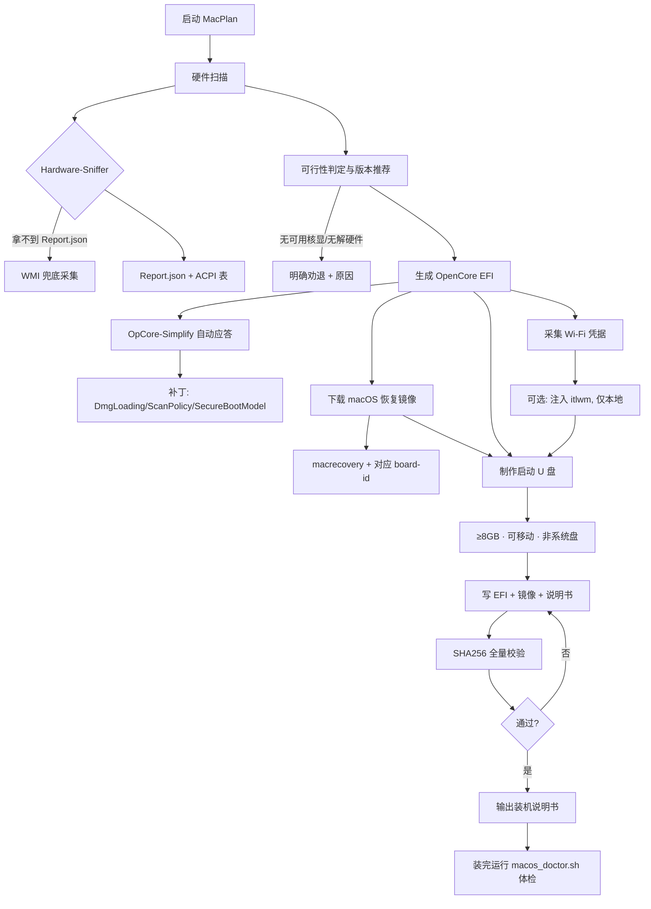

# MacPlan · 黑苹果一键装机助手

> 把「这台电脑能不能装 macOS」这个问题，变成一个跑完就有答案、有启动盘、有说明书的工具。

MacPlan 是一个 Windows 端工具：**检测硬件 → 推荐 macOS 版本 → 生成 OpenCore EFI → 制作可启动 U 盘 → 装后体检**，全部按顺序串起来，并把你可能踩的坑提前拦掉。

它不是又一个 EFI 生成器 —— EFI 生成交给成熟的开源项目 [OpCore-Simplify](https://github.com/lzhoang2801/OpCore-Simplify)，MacPlan 负责的是**判定、编排、校验和兜底**，也就是真正让人翻车的那部分。


> 八步：检测硬件 → 选对版本 → 做启动盘 → 进 BIOS → 引导 → 抹盘 → 安装 → 把 EFI 搬进硬盘

---

## 它解决什么问题

| 常见翻车点 | MacPlan 怎么处理 |
|---|---|
| 不知道自己的机器能不能装 | 扫描 CPU / 核显 / 网卡 / 声卡 / 触控板，给出「能/勉强/不能」和理由 |
| 选错系统版本 | 按 CPU 代次推荐到**原生支持的最后一代**，而不是「越新越好」 |
| 跑去用 OpenCore-Legacy-Patcher | 明确区分：**OCLP 只给真 Mac 用，PC 走 OpCore-Simplify** |
| U 盘做完，OpenCore 菜单里没有安装项 | 预先修好 `DmgLoading` / `ScanPolicy` / `SecureBootModel` 三个致命项 |
| 菜单项名字是乱码，认不出来 | 强制把 U 盘卷标改成 ASCII，避免 OpenCanopy 吞中文字形 |
| Wi-Fi 装完连不上，或者密码明文躺在 EFI 里 | 安装期用 itlwm 预置，装完提醒切 HeliPort 并把明文清掉 |
| 装完拔了 U 盘开不了机 | 校验硬盘 ESP 里到底有没有 `EFI/OC/OpenCore.efi`，而不是看 `nvram` |
| 装完没声音 / 触控板不动 | 装后体检脚本逐项给判据，避免「设备在、功能死」的误判 |

---

## 工作流



---

## 三步走（小白版）

一整套流程其实只有三段，每段都有独立的说明书：

| 阶段 | 在哪台机器上做 | 你要做的事 | 详细步骤 |
|---|---|---|---|
| **① 检测 + 做启动盘** | Windows | 跑 MacPlan，确认版本，写入 U 盘 | [小白指南 · 第一阶段](docs/小白安装指南.md#第一阶段--检测--做启动盘在-windows-上做) |
| **② BIOS + 引导** | 目标电脑 | 改四个开关，F9 选 U 盘，按空格找 macOS 项 | [小白指南 · 第二阶段](docs/小白安装指南.md#第二阶段--bios-设置--从-u-盘启动在目标电脑上做) |
| **③ 安装 + 装后调优** | 目标电脑 | 抹盘、安装、把 EFI 搬进硬盘、体检 | [小白指南 · 第三阶段](docs/小白安装指南.md#第三阶段--安装--第一次进系统) |

每一步都配了「失败会怎样、怎么退回」，不用回头翻聊天记录。

装的过程中卡住了，把 [装机陪跑提示词](docs/装机陪跑提示词.md) 整段丢给 AI，再贴现象和命令输出 —— 它被约束成"先给三个假设，每个假设配一条验证命令"。

---

## 快速开始

### 1. 直接用（打包好的 exe）

到 [Releases](../../releases) 下载 `MacPlan.exe`，双击运行，按提示走六步。

### 2. 从源码跑

```powershell
git clone https://github.com/jysjason97/MacOSPlan.git
cd MacOSPlan
python -m macplan            # 交互式向导
```

要求：Windows 10/11、Python 3.9+、能访问 GitHub 与 Apple 的下载服务器。

### 3. 分步执行（适合排障）

```powershell
python -m macplan scan                    # 只做硬件扫描，产出 Report.json
python -m macplan recommend               # 只做版本推荐
python -m macplan efi --report SysReport\Report.json --version 13
python -m macplan usb --drive D: --efi Results\EFI --recovery macrecovery\com.apple.recovery.boot
python -m macplan verify --drive D:
```

---

## 六步向导会问你什么

1. **准备一个不用的 U 盘**：≥ 8 GB，内容会被清空。工具会先验证它是不是可移动盘、是不是系统盘
2. **这台机器最终要连的 Wi-Fi**：SSID + 密码（可选，只写进本机 EFI，不上传任何服务器）
3. **是否单系统**：单系统会抹掉整块硬盘，工具会要求你二次确认并提醒备份
4. 扫描 → 推荐 → 生成 EFI → 制作 U 盘 → 校验，全程有日志

> ⚠️ **Wi-Fi 密码会被写进 `itlwm.kext/Contents/Info.plist`，而 EFI 在 FAT32 上是明文可读的。**
> MacPlan 会在说明书里明确写出这一点，并给出「装完切 HeliPort 后立即清除明文」的步骤。如果你不接受，可以在向导里选择「跳过 Wi-Fi 预置」。

---

## 两个必须说清楚的边界

**① OpCore-Legacy-Patcher 不能用在 PC 上。**
OCLP 是给**真 Mac**（2007 年起的旧机器）打补丁跑新系统的，它依赖苹果固件和原厂硬件。普通 PC 走的是 OpenCore + OpCore-Simplify 这条线，两者不是替代关系。

**② 不是所有机器都能装。**
没有可驱动的核显、也没有受支持的 AMD 独显的机器，macOS 装上也只是「能开机但没图形加速」，没有实用价值。MacPlan 遇到这种情况会直接给出劝退结论和硬件依据，而不是让你白折腾一天。

---

## 装完之后

仓库里带了一个 macOS 侧的体检脚本：

```bash
bash scripts/macos_doctor.sh
```

它逐项检查这次最容易漏的东西：硬盘 ESP 里有没有真正的 OpenCore、`LauncherOption` 是否 Bootstrap、`layout-id` 对不对、USB 端口映射有没有生效、蓝牙 kext 顺序、`pmset` 睡眠参数、时区是否被自动设成美国时间。

判据都写在脚本注释里，避免出现「设备节点在、功能其实死了」的误判（比如触控板看 `IOHIDDevice` 子节点永远是 0）。

---

## 小白 Tips（节选）

- **装应用去官网，不要用 App Store**：黑苹果的 App Store 依赖 iCloud 和 SMBIOS，经常登不上或下载失败
- **官网下载要选 Intel 版**（不是 Apple Silicon / ARM 版），你这台是 Intel 机器，ARM 版装不上
- **不要走 OTA 系统更新**，也不要用「磁盘工具 → 急救」修系统宗卷，这两件事在黑苹果上必翻车
- **Wi-Fi 用 HeliPort 管**，右上角没有 Wi-Fi 图标是正常的（itlwm 是以太网形态）
- **隔空投送 / 接力 / 定位 / 自动时区 / Type-C 视频输出 / 读卡器** 注定不可用，别花时间修
- **那张启动 U 盘别扔**，它是唯一的救命盘；第一次装完做一次 Time Machine
- **先别登 iCloud**，等声音、触控板、睡眠都正常了再登
- **改 `config.plist` 前先备份**，改坏了能换回来

完整 20 条在 [小白安装指南 · Tips](docs/小白安装指南.md#小白-tips这些没人会主动告诉你)。

---

## 文档

- [小白安装指南](docs/小白安装指南.md) —— 从零开始的图文步骤 + 20 条 Tips
- [装机陪跑提示词](docs/装机陪跑提示词.md) —— 整段复制给 AI，让它按排障流程陪你装
- [全流程踩坑清单](docs/踩坑清单.md) —— 从可行性判定到装后调优，按阶段整理
- [AI 诊断提示词](docs/AI诊断提示词.md) —— P0–P8 分场景提示词
- [使用手册](docs/使用手册.md) —— 向导每一步在干什么、失败怎么回退
- [架构与原理](docs/架构与原理.md) —— 为什么这么设计

---

## 参考与致谢

这个项目站在两个开源项目的肩膀上，装机前请先把它们收进书签：

| 项目 | 地址 | MacPlan 怎么用它 |
|---|---|---|
| **OpCore-Simplify** | https://github.com/lzhoang2801/OpCore-Simplify | 真正生成 OpenCore EFI 的引擎。MacPlan 调用它、自动应答菜单，再补上 `DmgLoading` / `ScanPolicy` / `SecureBootModel` 三个安装期必改项 |
| **OpenCore-Legacy-Patcher** | https://github.com/dortania/OpenCore-Legacy-Patcher | 给**真 Mac**（2007 年起的旧机器）打补丁跑新系统。⚠️ 它**不能**用在普通 PC 上，PC 走的是 OpenCore + OpCore-Simplify 这条线 |

另外两个间接依赖：镜像下载用 [OpenCorePkg 的 macrecovery](https://github.com/acidanthera/OpenCorePkg/tree/master/Utilities/macrecovery)，配置规范参考 [Dortania 的 OpenCore Install Guide](https://dortania.github.io/OpenCore-Install-Guide/)。

---

## 许可与免责

代码 MIT。**macOS 的软件许可只允许安装在苹果硬件上**，本项目仅作个人研究与技术学习用途，使用者自行承担全部风险：包括但不限于数据丢失、硬件损坏、保修失效、系统不稳定。

`docs/踩坑清单.md` 里的硬件结论来自一次真实装机（HP Pavilion 14-ce0xxx），换机器请重新扫描，不要照抄。
