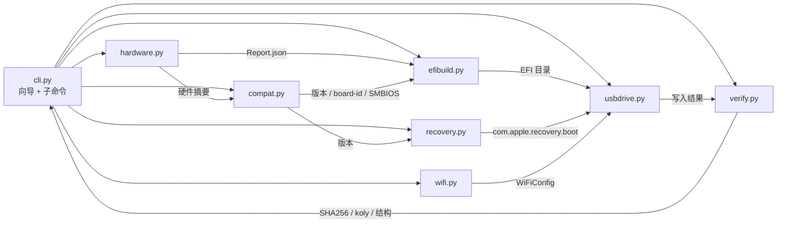

# 架构与原理

## 一句话

MacPlan 不生产 EFI，它是**判定 + 编排 + 校验**：把三个成熟开源项目的产物串成一条
不会在同一个地方翻车的流水线。

---

## 为什么不是"再造一个 EFI 生成器"

| 方案 | 结论 |
|---|---|
| 自己维护一套 kext/ACPI 模板 | ❌ 硬件组合爆炸，维护成本不可控 |
| 用 OpCore-Simplify 生成 | ✅ 它已经在做这件事，且跟 Dortania 指南同步 |
| 用 OpenCore-Legacy-Patcher | ❌ 只对真 Mac 有效，PC 上没有可打的补丁 |

所以分工是：

```
OpCore-Simplify  →  生成 EFI（它擅长）
macrecovery      →  下载恢复镜像（苹果官方脚本）
MacPlan          →  判可行性、编排顺序、修致命默认值、写盘、校验、装后体检
```

---

## 模块图



| 模块 | 职责 | 关键约束 |
|---|---|---|
| `hardware.py` | 采集 CPU/显卡/网卡/磁盘，产出 `Report.json` | 拿不到 Sniffer 时退回 WMI，但**声明不支持生成 EFI** |
| `compat.py` | 代次 → 版本，网卡 → 驱动形态 | 只推荐**原生支持**的版本，不越级 |
| `efibuild.py` | 驱动 OpCore-Simplify，打四个补丁 | 版本固定，应答留日志 |
| `recovery.py` | macrecovery 封装 | 必须有 board-id 映射，否则拒绝 |
| `wifi.py` | 读 netsh 配置，写 itlwm | 只本地、只明文、必须可清除 |
| `usbdrive.py` | 枚举 USB、守卫、写入 | 三重守卫，格式化需显式 `YES` |
| `verify.py` | 写后校验 | 三项全过才算成功 |

---

## 几个关键设计决定

### 1. 只推荐"原生最高版本"，不推荐"最新版本"

macOS 每换代都会砍掉一批机型。Kaby Lake 停在 Ventura，再往上就是打补丁，
补丁在小众硬件上意味着：核显花屏、睡眠崩、更新失败。

**取舍**：少一个新功能，换一个能天天用的系统。

### 2. `DmgLoading` 默认就改成 `Any`

这是本次装机最隐蔽的坑：`Signed` 校验不过时，恢复项**被静默过滤**，
菜单里什么都不显示，也没有任何提示。

**取舍**：牺牲一次签名校验，换"能看到安装项"。安装期本来也不需要 Secure Boot。

### 3. 卷标强制 ASCII

OpenCanopy 的字体不含中文字形，中文卷标会渲染成 `___U___`，
用户会以为引导失败。

**取舍**：牺牲一个好看的名字，换"一眼能认出这是 macOS 项"。

### 4. 格式化不做"自动"，只做"守卫 + 显式确认"

`format_fat32()` 要求 `confirm="YES"`，并且先过三重守卫：
USB 总线、非系统盘（盘符与磁盘号交叉核对）、≥7.4GiB。

**取舍**：多一次手动确认，换"不可能误抹用户的移动硬盘"。

### 5. Wi-Fi 明文写进 EFI，但必须可清除

预置 Wi-Fi 的价值很大（恢复环境直接联网，不用找网线）。
但 EFI 是 FAT32，拿到 U 盘的人 `cat Info.plist` 就能看到密码。

所以：
- 向导里明确告知代价，默认开启但可以跳过；
- 说明书里给出"装完用 HeliPort 连上后立即删除 `WiFiConfig`"的步骤；
- `.gitignore` 里明确排除 `EFI/`，防止有人把带密码的 EFI 推到 GitHub。

### 6. 全流程留日志

`logs/macplan.log` 记录每一步；驱动 OpCore-Simplify 时额外写 `macplan_answers.log`，
逐条记录"提示词 → 输入值"。

**取舍**：多占几 KB，换"失败时能定位到具体哪个菜单项"。

---

## 数据流：一次完整运行

```
wizard()
 ├─ usbdrive.list_usb()            # 枚举 USB 磁盘
 ├─ usbdrive.guard(disk)          # 容量/健康/盘符交叉核对
 ├─ wifi.collect()                # netsh 读取（本地）
 ├─ hardware.collect(SysReport)   # Sniffer → Report.json；失败退 WMI
 ├─ compat.evaluate(hw)           # → Recommendation(verdict/version/board_id/smbios)
 ├─ efibuild.build(report, ver)   # OpCore-Simplify → Results/EFI
 │   └─ patch_config()            # DmgLoading / SecureBootModel / ScanPolicy / LauncherOption
 ├─ recovery.download_recovery()  # macrecovery → BaseSystem.dmg
 ├─ usbdrive.write_payload()      # EFI + recovery + 使用说明.txt
 ├─ wifi.patch_itlwm()            # 可选，改 kext 的 Info.plist
 └─ verify.verify()               # 树哈希 + koly + 引导结构
```

任何一步抛异常 → `cli.main()` 捕获 → 写日志 → 返回非零退出码。
向导不会"带病继续"。

---

## 安全模型

| 风险 | 控制手段 |
|---|---|
| 误格式化系统盘 | 只枚举 `BusType -eq 'USB'`；盘符与磁盘号交叉核对；需输入 `YES` |
| 写坏盘导致安装失败 | 写后三项校验，任一失败即判失败 |
| Wi-Fi 密码泄露 | 默认告知代价、可跳过、只在本地、`.gitignore` 排除 EFI |
| 供应链 | OpCore-Simplify 版本固定（`MACPLAN_OPCORE_TAG`），压缩包直链不走 API |
| 权限 | 全程不做提权；格式化由用户在系统 UI 确认 |

---

## 扩展点

- **新平台**：`compat.py` 的 `INTEL_TABLE` 加一行，`SMBIOS_BY_GEN` 加一行
- **新版本**：`BOARD_ID` 加 board-id（必须到 Dortania 核对，不要猜）
- **新网卡方案**：`compat._wifi_advice()` 加分支
- **检查项**：`scripts/macos_doctor.sh` 追加一个 `title/ok/bad` 块
- **CI**：打 tag 即出 Release（`.github/workflows/build.yml`）

---

## 测试策略

| 层级 | 方式 |
|---|---|
| 单元 | `compat.evaluate()` 用固定硬件字典断言结论；`recovery.check_dmg()` 用截断文件断言失败 |
| 集成 | `scan → recommend` 可在任意 Windows 机器跑通 |
| 端到端 | 需要真实 U 盘与目标机；跑完必须 `verify` 通过 |
| 回归 | 每次改 `ANSWER_RULES` 都要重跑一次 EFI 生成，比对 `Results/EFI` 的文件数 |

> 本项目没有 mock 硬件的能力，所以"能不能装"永远以 `Report.json` + 实机验证为准。
